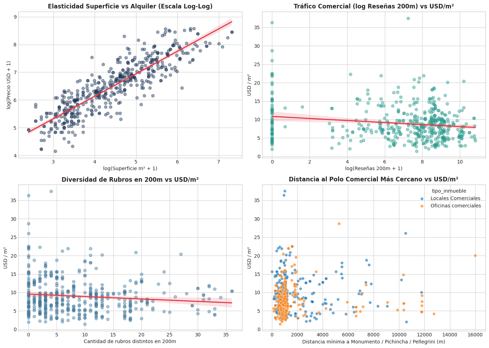
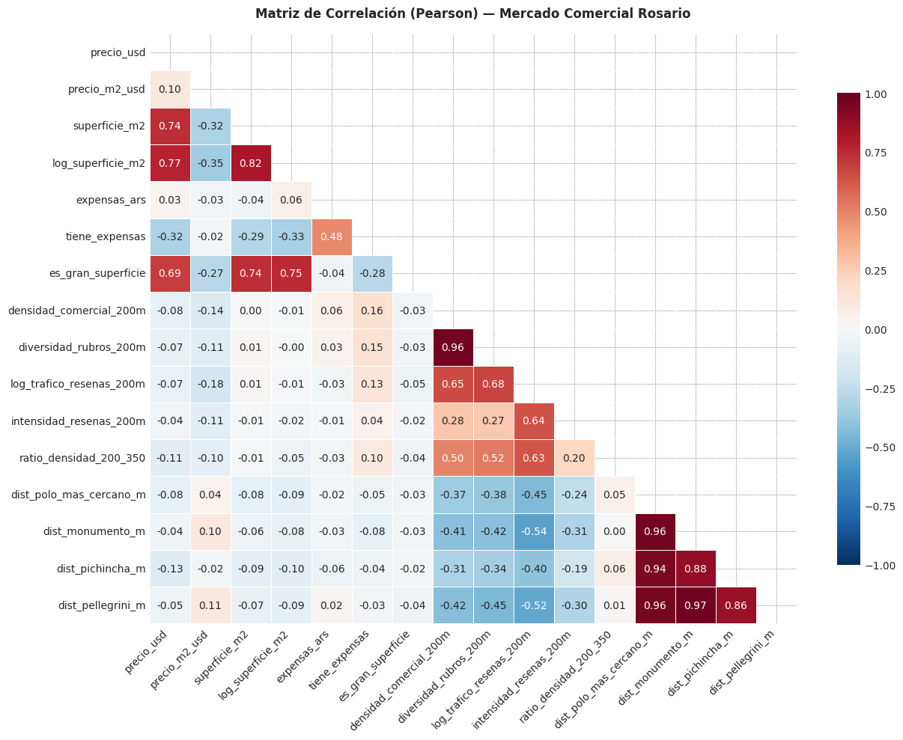

# 🏢 Inmobify — Inteligencia Geoespacial y Valuación del Mercado Inmobiliario Comercial (Rosario)

**Samsung Innovation Campus (SIC) — Capstone Project Integral (Analytics + Machine Learning + Automatización en la Nube)**

---

## 👥 Equipo de Trabajo

- **Nombre del Grupo:** Ex UM
- **Nombre del Proyecto:** Inmobify — Plataforma End-to-End de Análisis y Tasación Predictiva de Inmuebles Comerciales en Rosario
- **Integrantes:**
  - Francisco Lovatti
  - Matias Radice

---

## 💡 ¿Qué es Inmobify y qué problema soluciona?

En el mercado de alquileres comerciales de **Rosario** (locales comerciales y oficinas), fijar un canon locativo justo o detectar oportunidades de inversión es complejo porque los precios publicados presentan una enorme dispersión incluso dentro de un mismo barrio. Dos locales con igual superficie en el *Centro* o *Pichincha* pueden valer el doble o la mitad según su **micro-entorno comercial** (flujo peatonal, concentración de comercios en la cuadra y cercanía a polos gastronómicos o financieros).

**Inmobify** resuelve esta asimetría de información mediante un **ecosistema automatizado de Ciencia de Datos**:
1. **Unifica y limpia** datos inmobiliarios reales con un maestro georreferenciado de comercios y actividad urbana de Rosario.
2. **Enriquece cada propiedad** calculando variables espaciales en radios de 200 m y 350 m (densidad comercial, diversidad de rubros, proxy de tráfico peatonal por reseñas y distancia a polos comerciales).
3. **Estima el valor justo de mercado ($\text{USD/mes}$ y $\text{USD/m}^2$)** mediante modelos de Machine Learning entrenados sobre el mercado rosarino y clasifica automáticamente si una propiedad publicada es una **Oportunidad** ($\ge 15\%$ bajo tasación), está en **Precio de Mercado** o está **Sobrevaluada** ($\ge 15\%$ sobre tasación).
4. **Democratiza su uso sin barreras técnicas:** tanto desde una aplicación web interactiva en **Streamlit** como desde una planilla operativa de **Google Sheets** orquestada por **Make**, donde cualquier usuario puede ingresar simplemente la **dirección** (ej. `"Bv. Oroño 850"`) o el **barrio**, sin necesidad de conocer coordenadas geográficas ni detalles técnicos de los modelos.

---

## 🔗 Ecosistema y Recursos en Producción

| Componente | Tecnología | Función en el Sistema | Enlace |
| :--- | :--- | :--- | :--- |
| **Aplicación Web & Tasador en Vivo** | Streamlit Cloud (`dashboard/app.py`) | Exploración EDA, mapa interactivo y tasador predictivo en tiempo real (Individual y Lote CSV) | [inmobify.streamlit.app](https://inmobify.streamlit.app) |
| **Actor 1: ETL & Feature Engineering** | Apify (`inmobify2/inmobify-preprocessing`) | Limpieza, conversión ARS/USD, cálculo Haversine y generación del dataset curado (33 variables) | [Repositorio actor Preprocessing](https://github.com/franlovatti/inmobify-preprocessing) |
| **Actor 2: Motor de Inferencia ML** | Apify (`inmobify2/inmobify`) | Geocodificación automática (Google/OSM), enriquecimiento en vivo y predicción con 11 modelos | [Repositorio actor Inference](https://github.com/franlovatti/inmobify) |
| **Orquestación ETL (Entrega 1)** | Make + Google Drive | Ingesta automática de datasets crudos hacia Apify KV Store y respaldo de resultados | [Escenario Make ETL](https://us2.make.com/public/shared-scenario/xX9odpDyFj5/inmobiby-preprocessing) |
| **Orquestación Tasaciones (Entrega 2)** | Make + Google Sheets | Flujo batch/individual desde planilla `Consultas` hacia Apify e historial en `Tasaciones` | [Escenario Make Inference](https://us2.make.com/public/shared-scenario/yk6QatPM1JQ/inmobify) |
| **Repositorio de Datasets** | Google Drive + Apify KV Store | Insumos crudos y `dataset_inmobiliario_completo_rosario.csv` | [Crudos](https://drive.google.com/drive/folders/1ocF57VMkUzPyvAdw0Y-cl2pmDxBNS3VL?usp=drive_link) · [Resultados](https://drive.google.com/drive/folders/1ghXKHo9peCMlSjbvKN7nSISs9E2WdDcN?usp=drive_link) |

---

## ⚙️ Arquitectura End-to-End del Proyecto

El sistema se divide en dos pipelines desacoplados conectados a través de **Apify Key-Value Store (`inmobify-storage`)**:

```text
====================================================================================================
FASE 1: INGESTA, LIMPIEZA, ENRIQUECIMIENTO GEOESPACIAL Y EDA (Batch ETL)
====================================================================================================
[Fuentes Crudas: Zonaprop + Google Places/OSM]
  ├── raw_zonaprop_rosario.csv (1.079 avisos inmobiliarios)
  └── maestro_comercios_rosario.csv (2.100 comercios georreferenciados)
            │
            ▼  (Make + Apify Actor: inmobify-preprocessing)
[Dataset Curado: 477 propiedades válidas × 33 variables] ──► [Apify KV Store: inmobify-storage]

====================================================================================================
FASE 2: ENTRENAMIENTO, SELECCIÓN DE MODELOS E INFERENCIA EN PRODUCCIÓN (ML & App)
====================================================================================================
[Notebook: inmobify_entrenamiento.ipynb]
  └── Validación Cruzada (5-Fold CV) + Test (20%) ─► 11 modelos serializados (.pkl + SHA-256)
                                                               │
[Google Sheets: Hoja 'Consultas'] ──► (Make) ──┐               ▼
[Streamlit Web: Individual / CSV] ─────────────┴──► [Apify Actor: inmobify-inference]
                                                      ├── 1. Geocodificación (Dirección / Barrio / GPS)
                                                      ├── 2. Entorno comercial vivo (Haversine 200 m)
                                                      └── 3. Tasación USD + Diagnóstico de Mercado
                                                               │
                                         ┌─────────────────────┴─────────────────────┐
                                         ▼                                           ▼
                          [Streamlit: Mapa & KPIs en Vivo]            [Google Sheets: Hoja 'Tasaciones']

```

---

## 🗄️ Fuentes de Datos y Proceso de Curación

### 1. **Oferta Inmobiliaria Comercial (`raw_zonaprop_rosario.csv`):**
* **Origen:** Relevamiento mediante web scraping sobre publicaciones comerciales de Rosario (`1.079` registros iniciales).
* **Curación:** Estandarización monetaria (conversión de avisos en pesos argentinos a USD mediante cotización de referencia), filtrado estricto al polígono geográfico de Rosario, imputación controlada de expensas/atributos faltantes y remoción de valores atípicos extremos (superficies o precios inverosímiles), consolidando **477 inmuebles comerciales validados** (*Locales comerciales* y *Oficinas*).

### ¿Por qué entrenar con 477 registros curados en lugar de imputar los 1.079 crudos?

El filtrado de **1.079 registros iniciales a 477 inmuebles validados** responde a un criterio estricto de integridad de datos para evitar contaminar el aprendizaje de los modelos:

1. **Deduplicación de avisos:** Eliminación de publicaciones repetidas por distintas inmobiliarias o renovaciones dentro del portal.
2. **Prohibición de imputación sobre la variable objetivo (`precio_usd`):** Muchos avisos figuran como *"Consultar"* o con montos simbólicos (`$ 1`). Rellenar precios faltantes con medias o medianas barriales fabricaría etiquetas artificiales que anularían el efecto de las variables micro-geográficas (densidad comercial y tráfico a 200 m).
3. **Integridad de superficie y moneda:** Se descartaron registros sin metraje válido (`superficie_m2`) o con inconsistencias evidentes entre moneda y monto publicado, evitando aplicar conversiones especulativas que introdujeran sesgo en el target.
4. **Frontera geográfica estricta de Rosario:** Se excluyeron publicaciones ubicadas en localidades vecinas del Gran Rosario (Funes, Roldán, Villa Gobernador Gálvez, Pérez) o sin coordenadas válidas, dado que el maestro de comercios cubre exclusivamente el ejido urbano de Rosario.
5. **Homogeneidad de segmento:** Se acotó la muestra a **Locales comerciales** y **Oficinas**, excluyendo depósitos industriales, galpones o cocheras que responden a otra estructura de costos.

> **Enfoque metodológico:** En problemas de valuación inmobiliaria, entrenar con **477 observaciones reales y verificadas** garantiza que el modelo aprenda relaciones genuinas entre ubicación, entorno comercial y precio, reservando la inferencia para estimar el valor de referencia de propiedades sin precio publicado.


### 2. **Actividad Comercial y Flujo Urbano (`maestro_comercios_rosario.csv`):**
* **Origen:** Relevamiento geoespacial de **2.100 comercios, locales gastronómicos, servicios e instituciones** de Rosario con coordenadas, categoría/rubro y cantidad de reseñas de usuarios.
* **Uso:** Sirve como base espacial de consulta tanto en el ETL histórico como en el motor de inferencia en vivo para cuantificar la vitalidad comercial a 200 metros de cada propiedad.


---

## 📊 Recorrido por el Análisis Exploratorio (EDA) y Variables Clave

El análisis exploratorio reveló patrones estructurales y espaciales determinantes para el diseño de variables (*Feature Engineering*):

### 1. Asimetría del Mercado y Diferenciación por Tipo de Inmueble y Barrio
- **Distribución sesgada (cola derecha):** Tanto el alquiler mensual (mediana global de **USD 750/mes**) como el valor unitario (mediana de **USD 8,06/m²/mes**) presentan fuerte asimetría positiva debido a locales emblemáticos en arterias principales.
- **Locales Comerciales vs. Oficinas:** Los **Locales Comerciales** exhiben una mediana superior (**~USD 9,05/m²**) y mayor amplitud intercuartílica que las **Oficinas Comerciales** (**~USD 7,25/m²**), reflejando el valor de la vidriera a la calle y el tránsito peatonal.
- **Dispersión Inter e Intra-Barrial:** Barrios consolidados o de alto perfil como **Puerto Norte** (mediana ~USD 12,5/m²) y **Nuestra Señora de Lourdes** (mediana ~USD 13,0/m²) superan ampliamente a sectores residenciales/periféricos como **Fisherton** o **Martín**, aunque en barrios masivos como **Centro** coexisten inmuebles desde USD 3/m² hasta más de USD 35/m².

### 2. Relaciones Estructurales y Geoespaciales (Análisis Bivariado y Correlaciones)
- **Elasticidad Escala-Precio (`log_superficie_m2` vs. `log_precio_usd`):** La superficie presenta una fuerte correlación lineal con el canon total ($r = +0,74$ en escala natural y **$r = +0,77$** en escala log-log), pero una **correlación negativa con el valor unitario** ($r = -0,35$ con `precio_m2_usd`), demostrando economías de escala: a mayor metraje, menor costo por metro cuadrado.
- **Impacto de Expensas (`tiene_expensas`):** Presenta correlación negativa con el alquiler ($r = -0,32$), ya que los inmuebles bajo régimen de consorcio con altas expensas ajustan su canon base para mantener competitividad.
- **Sinergia del Entorno Comercial a 200 m:** La `densidad_comercial_200m` (0 a 71 comercios), la `diversidad_rubros_200m` (0 a 36 rubros, $r = +0,96$ entre ambas) y el `log_trafico_resenas_200m` guardan una marcada correlación inversa con la distancia a los polos urbanos ($r = -0,54$ respecto al Monumento y $r = -0,52$ respecto a Av. Pellegrini), capturando el gradiente de centralidad comercial de la ciudad.

#### Evidencia Visual del Análisis Exploratorio

| Distribuciones y Dispersión Barrial | Elasticidad Log-Log y Entorno Comercial |
| :---: | :---: |
|  |  |
| *Asimetría de precios (USD/mes), brecha Local vs. Oficina y dispersión por barrio.* | *Elasticidad superficie-alquiler ($r = +0,77$) y efecto de comercios/polos cercanos.* |

<p align="center">
  
  <br>
  <em>Matriz de correlación de Pearson entre variables estructurales, monetarias y métricas geoespaciales Haversine.</em>
</p>

### 3. Resumen de Features Seleccionadas para el Modelado (10 Predictoras)

| Variable | Naturaleza | Justificación Analítica |
| --- | --- | --- |
| `log_superficie_m2` | Numérica (Lineal) | Modela la elasticidad log-log entre tamaño y precio ($r = +0,77$) |
| `superficie_m2` | Numérica (Lineal) | Escala física directa en metros cuadrados |
| `es_gran_superficie` | Binaria (Lineal) | Captura el cambio de régimen en inmuebles $> 200\text{ m}^2$ ($r = +0,69$) |
| `tiene_expensas` | Binaria (Lineal) | Penalización/ajuste del alquiler neto por expensas ($r = -0,32$) |
| `barrio` | Categórica (OHE / TE) | Nivel base de precios y prestigio urbano del sector |
| `tipo_inmueble` | Categórica (OHE) | Diferenciación estructural entre *Local comercial* y *Oficina* |
| `log_trafico_resenas_200m` | Numérica (No Lineal) | Proxy de intensidad de flujo peatonal en un radio de 200 metros |
| `densidad_comercial_200m` | Numérica (No Lineal) | Cantidad absoluta de comercios vecinos en 200 metros |
| `diversidad_rubros_200m` | Numérica (No Lineal) | Variedad de rubros comerciales inmediatos (efecto atracción) |
| `dist_polo_mas_cercano_m` | Numérica (No Lineal) | Distancia mínima Haversine a Monumento, Pichincha, Pellegrini, Alto Rosario o Portal |

---

## 🎯 Métricas de Evaluación y Criterios de Negocio

Debido a la **fuerte asimetría positiva (cola derecha)** verificada en el EDA —donde un pequeño grupo de locales de gran superficie supera los USD 3.000–5.000/mes frente a una mediana global de USD 750/mes—, métricas tradicionales basadas en errores cuadráticos como el **RMSE** resultan inadecuadas como criterio principal porque quedan dominadas por los errores absolutos en inmuebles grandes y penalizan poco los desvíos en locales chicos.

Por ello se adoptó un esquema de evaluación integral que combina **precisión relativa**, **error monetario unitario**, **capacidad explicativa estadística** y **accionabilidad comercial**:

### 1. Métricas Técnicas de Selección y Diagnóstico

1. **MAPE (Mean Absolute Percentage Error — Error Porcentual Absoluto Medio) `[Criterio Principal de Ranking]`:**
   - **Fórmula:** $\text{MAPE} = \frac{100\%}{n} \sum_{i=1}^{n} \left| \frac{y_i - \hat{y}_i}{y_i} \right|$
   - **Por qué se utiliza:** Evalúa el error relativo porcentual otorgando exactamente el **mismo peso** a un local pequeño de USD 350/mes que a una esquina comercial de USD 2.500/mes, evitando el sesgo por escala. En nuestro modelo campeón (`Ensamble Top-3`), el error en validación cruzada (5-Fold CV) es de **32,72 %**.

2. **MAE Unitario en $\text{USD/m}^2$ (Mean Absolute Error por Metro Cuadrado) `[Criterio de Interpretabilidad Inmobiliaria]`:**
   - **Fórmula:** $\text{MAE}_{\text{m}^2} = \frac{1}{n} \sum_{i=1}^{n} \left| \frac{y_i}{m^2_i} - \frac{\hat{y}_i}{m^2_i} \right|$
   - **Por qué se utiliza:** Traduce el desvío del modelo a **dólares por metro cuadrado** (en nuestro modelo campeón: **$\text{MAE} = \text{USD } 2,53/\text{m}^2$** en conjunto de prueba), una unidad directa y comprensible para cualquier tasador, corredor inmobiliario o inversor.

3. **Coeficiente de Determinación ($R^2$ en escala logarítmica y en USD) `[Métrica de Explicabilidad]`:**
   - **Fórmula:** $R^2 = 1 - \frac{\sum_{i=1}^{n} (y_i - \hat{y}_i)^2}{\sum_{i=1}^{n} (y_i - \bar{y})^2}$
   - **Por qué se utiliza:** Cuantifica qué proporción de la varianza total de precios del mercado rosarino logran explicar nuestras variables estructurales y geoespaciales frente a predecir simplemente el promedio global. Se reporta como métrica complementaria de ajuste global (especialmente informativa en escala logarítmica $R^2_{\log}$, donde la varianza está estabilizada) y no como criterio único de ranking porque en escala monetaria pura hereda la sensibilidad cuadrática a los extremos de la cola derecha.

4. **RMSE (Root Mean Squared Error) `[Métrica de Control de Outliers]`:**
   - **Por qué se utiliza:** Se monitorea únicamente de forma diagnóstica para detectar si algún estimador genera predicciones explosivas en inmuebles de gran superficie ($> 200\text{ m}^2$), razón por la cual el target se entrena bajo transformación logarítmica (`TransformedTargetRegressor` con `log1p`/`expm1`) y se incorpora `HuberRegressor` dentro del ensamble.

### 2. Métricas de Negocio y Diagnóstico en Producción

5. **Índice de Precio Relativo ($\text{IPR}$) y Diagnóstico de Mercado:**
   - Compara el valor publicado por el oferente frente a la tasación estimada por el modelo ($\Delta\% = \frac{\text{Precio Publicado} - \text{Precio Predicho}}{\text{Precio Predicho}} \times 100$) para emitir una recomendación accionable inmediata:
     - **Oportunidad ($\le -15\%$):** Propiedad publicada al menos 15 % por debajo de su valor estimado de mercado.
     - **Precio de Mercado ($-15\% \text{ a } +15\%$):** Valor alineado con las características físicas y el entorno comercial de la zona.
     - **Sobrevaluado ($\ge +15\%$):** Canon locativo publicado 15 % o más por encima de la tasación esperada.
     - **Tasación de Referencia:** Valor sugerido de salida al mercado cuando el inmueble aún no tiene precio publicado.

---

## 🤖 Estrategia de Modelado y Comparativa de los 11 Estimadores

En `inmobify_entrenamiento.ipynb` se entrenaron y compararon **11 arquitecturas de regresión** bajo un esquema riguroso de preprocesamiento (`ColumnTransformer` con imputación, escalado robusto/estándar y codificación categórica) sobre el dataset curado (**477 propiedades**, split **80 % Train / 20 % Test** y validación cruzada **5-Fold CV**) aplicando `TransformedTargetRegressor` (`np.log1p` / `np.expm1`) sobre `precio_usd` y las 10 variables predictoras (`4 lineales + 6 no lineales/categóricas`):

| Ranking | Modelo | Familia / Arquitectura | Rol en Producción | Observaciones Técnicas y Comportamiento en Evaluación |
| :---: | :--- | :--- | :--- | :--- |
| **1** | **`Ensamble Top-3`** | `VotingRegressor` (`Gradient Boosting` + `HuberRegressor` + `LightGBM`) | **Modelo Campeón (Default)** | Combina captura no lineal de interacciones espaciales con robustez frente a outliers (`CV MAPE: 32,72%` \| `Test MAE: USD 2,53/m²`). Maximiza estabilidad en $R^2_{\log}$ y minimiza desvíos extremos. |
| **2** | **`Gradient Boosting`** | Ensamble secuencial de árboles (`GradientBoostingRegressor`) | Integrante del Ensamble | Excelente ajuste en interacciones entre superficie logarítmica y proximidad a polos comerciales; líder individual entre modelos basados en árboles. |
| **3** | **`HuberRegressor`** | Regresión lineal robusta (pérdida cuadrática + lineal en colas) | Integrante del Ensamble | Estabiliza las predicciones y controla el **RMSE** frente a locales atípicos de gran metraje sin perder interpretabilidad estructural. |
| **4** | **`LightGBM`** | Gradient Boosting basado en histogramas (`LGBMRegressor`) | Integrante del Ensamble | Alta eficiencia en particiones sobre variables de densidad comercial y diversidad de rubros a 200 m. |
| **5** | **`ElasticNet`** | Regresión lineal con penalización mixta $L_1 + L_2$ | Alternativa Lineal | Regulariza colinealidades entre `superficie_m2`, `log_superficie_m2` y `es_gran_superficie`, manteniendo buen $R^2_{\log}$ con baja varianza. |
| **6** | **`Ridge`** | Regresión lineal con regularización $L_2$ | Alternativa Lineal | Conserva todas las variables con pesos suavizados; útil como baseline paramétrico interpretable. |
| **7** | **`Lasso`** | Regresión lineal con selección de variables $L_1$ | Alternativa Lineal | Penaliza a cero las variables de menor aporte marginal directo. |
| **8** | **`XGBoost`** | Extreme Gradient Boosting (`XGBRegressor`) | Alternativa Boosting | Regularización explícita en hojas; comportamiento competitivo en muestra media, ligeramente más sensible a sobreajuste que Gradient Boosting en $n=477$. |
| **9** | **`SVR (RBF)`** | Support Vector Regression con kernel Gaussiano | Alternativa Kernel | Captura fronteras suaves no lineales, sensible al escalado de features espaciales y a los extremos de superficie. |
| **10** | **`Random Forest`** | Ensamble paralelo de árboles (`RandomForestRegressor`) | Alternativa Bagging | Reduce varianza respecto a un árbol único, aunque tiende a suavizar extremos en las colas altas de precio. |
| **11** | **`KNN Regressor`** | Vecinos más cercanos ponderados por distancia | Baseline No Paramétrico | Sensible a la dimensionalidad tras el One-Hot Encoding de barrios; utilizado como referencia base de proximidad pura. |

### Trazabilidad e Integridad en Producción (`modelos_ranking_meta.json`)
- **Verificación Criptográfica:** Cada archivo `.pkl` dentro de `modelos_entrenados/` cuenta con su hash **SHA-256** registrado en `modelos_ranking_meta.json`, verificado en tiempo de ejecución por `src/model_defs.py` antes de deserializar.
- **Auditoría por Consulta:** En cada inferencia (tanto en Streamlit como en Make/Google Sheets), el sistema devuelve `modelo_utilizado`, `modelo_cv_mape_pct` y `modelo_test_mae_m2_usd` junto con la tasación y el diagnóstico de mercado.

### Tabla Comparativa Completa (`modelos_ranking_meta.json`)

| Ranking | Modelo | CV MAPE (%) | CV MAE ($\text{USD/m}^2$) | CV MAE Total (USD) | CV $R^2_{\log}$ | Test MAPE (%) | Test MAE ($\text{USD/m}^2$) | Test MAE Total (USD) | Tiempo Entrenamiento (s) |
| :---: | :--- | :---: | :---: | :---: | :---: | :---: | :---: | :---: | :---: |
| **1** | **`Ensamble Top-3`** *(Campeón)* | **32,72 %** | **2,71** | **339,1** | **0,817** | **36,81 %** | **2,53** | **273,5** | 8,91 |
| **2** | **`Gradient Boosting`** *(Ensamble)* | 33,07 % | 2,74 | 339,7 | 0,813 | 37,92 % | 2,59 | 297,7 | 72,59 |
| **3** | **`HuberRegressor`** *(Ensamble)* | 33,99 % | 2,82 | 355,4 | 0,805 | 37,74 % | 2,60 | 283,0 | 21,24 |
| **4** | **`LightGBM`** *(Ensamble)* | 34,92 % | 2,82 | 376,4 | 0,805 | 37,59 % | 2,58 | 286,6 | 8,84 |
| **5** | **`ElasticNet`** | 34,96 % | 2,83 | 353,2 | 0,806 | 38,16 % | 2,56 | 279,4 | 3,26 |
| **6** | **`Ridge`** | 34,98 % | 2,82 | 353,7 | 0,807 | 38,91 % | 2,59 | 286,5 | 3,10 |
| **7** | **`Lasso`** | 35,02 % | 2,84 | 354,5 | 0,805 | 38,72 % | 2,58 | 285,0 | 4,08 |
| **8** | **`XGBoost`** | 35,37 % | 2,83 | 369,7 | 0,805 | 37,40 % | 2,52 | 295,3 | 10,68 |
| **9** | **`SVR (RBF)`** | 35,41 % | 2,87 | 371,3 | 0,805 | 37,36 % | 2,64 | 260,0 | 4,25 |
| **10** | **`Random Forest`** | 35,43 % | 2,87 | 365,0 | 0,802 | 38,19 % | 2,60 | 292,5 | 136,36 |
| **11** | **`KNN Regressor`** | 37,03 % | 2,89 | 383,3 | 0,802 | 44,81 % | 2,97 | 361,8 | 1,41 |

### Hallazgos Clave del Benchmark
- **Superioridad del Ensamble como modelo final seleccionado (`Ensamble Top-3`):** Al combinar `Gradient Boosting`, `HuberRegressor` y `LightGBM` mediante `VotingRegressor`, el ensamble supera a todos los modelos individuales tanto en **CV MAPE (`32,72 %`)**, **CV MAE (`USD 2,71/m²`)**, **CV $R^2_{\log}$ (`0,817`)** como en **Test MAPE (`36,81 %`)**, promediando las fortalezas no lineales de los árboles con la estabilidad frente a valores atípicos de la regresión robusta de Huber.
- **Eficiencia Computacional:** Mientras `Random Forest` y `Gradient Boosting` requieren `136,36 s` y `72,59 s` respectivamente para el ajuste y búsqueda de hiperparámetros, el `Ensamble Top-3` ya configurado entrena en apenas **`8,91 s`** y ejecuta inferencias en milisegundos.
- **Integridad y Trazabilidad (`modelos_ranking_meta.json`):** Cada modelo `.pkl` almacenado en `inmobify-storage` cuenta con verificación criptográfica **SHA-256** antes de su deserialización y reporta automáticamente sus métricas de validación junto a cada tasación emitida.

---

## 📂 Estructura del Repositorio

```text
inmobify-capstone-project/
├── assets/                                  # Imagenes de soporte
├── dashboard/
│   └── app.py                               # Dashboard interactivo en Streamlit (EDA, Mapa y Tasador en Vivo)
├── inmobify_scrappeo_prueba_etl_eda.ipynb   # Notebook Entrega 1: Scraping, ETL, Feature Engineering y EDA
├── inmobify_entrenamiento.ipynb             # Notebook Entrega 2: Experimentación, CV y benchmarking de 11 modelos
├── prueba-api-inferencia.py                 # Cliente de prueba para validación de inferencia individual y en lote vía SDK
├── requirements.txt                         # Dependencias de Python para ejecución del dashboard y scripts
├── .gitignore                               # Exclusión de credenciales (.streamlit/secrets.toml, .env) y archivos temporales
└── README.md                                # Documentación integral del proyecto

```

*(Los microservicios serverless desplegados en Apify —`inmobify-preprocessing` e `inmobify-inference`— operan conectados a este repositorio y al Key-Value Store `inmobify-storage`).*

---

## 🚀 Ejecución Local del Dashboard

1. **Clonar el repositorio e instalar dependencias:**
```bash
git clone [https://github.com/franlovatti/Inmobify-capstone-project.git](https://github.com/franlovatti/Inmobify-capstone-project.git)
cd Inmobify-capstone-project
pip install -r requirements.txt

```


2. **Configurar el token de Apify para habilitar el Tasador en Vivo:**
Creá el archivo `.streamlit/secrets.toml` en la raíz del proyecto:
```toml
APIFY_TOKEN = "apify_api_tu_token_aqui"
APIFY_ACTOR_ID = "inmobify2/inmobify"

```


3. **Iniciar la aplicación:**
```bash
streamlit run dashboard/app.py

```