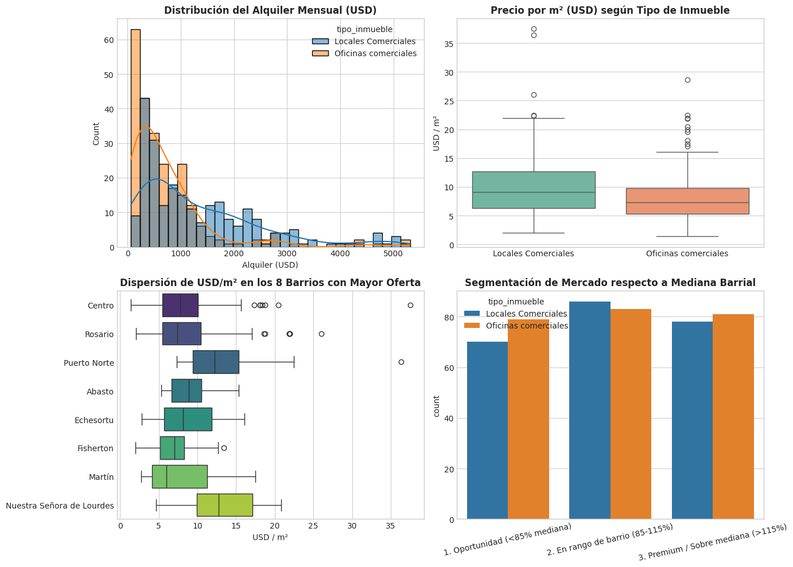

# 🏢 Inmobify — Inteligencia Geoespacial y Valuación del Mercado Inmobiliario Comercial (Rosario)

**Samsung Innovation Campus (SIC) — Capstone Project Integral (Analytics + Machine Learning + Automatización en la Nube)**

---

## 👥 Equipo de Trabajo

- **Nombre del Grupo:** Ex UM
- **Nombre del Proyecto:** Inmobify — Plataforma End-to-End de Análisis y Tasación Predictiva de Inmuebles Comerciales en Rosario
- **Integrantes:**
  - Francisco Lovatti
  - Matias Radice

---

## 💡 ¿Qué es Inmobify y qué problema soluciona?

En el mercado de alquileres comerciales de **Rosario** (locales comerciales y oficinas), fijar un canon locativo justo o detectar oportunidades de inversión es complejo porque los precios publicados presentan una enorme dispersión incluso dentro de un mismo barrio. Dos locales con igual superficie en el *Centro* o *Pichincha* pueden valer el doble o la mitad según su **micro-entorno comercial** (flujo peatonal, concentración de comercios en la cuadra y cercanía a polos gastronómicos o financieros).

**Inmobify** resuelve esta asimetría de información mediante un **ecosistema automatizado de Ciencia de Datos**:
1. **Unifica y limpia** datos inmobiliarios reales con un maestro georreferenciado de comercios y actividad urbana de Rosario.
2. **Enriquece cada propiedad** calculando variables espaciales en radios de 200 m y 350 m (densidad comercial, diversidad de rubros, proxy de tráfico peatonal por reseñas y distancia a polos comerciales).
3. **Estima el valor justo de mercado ($\text{USD/mes}$ y $\text{USD/m}^2$)** mediante modelos de Machine Learning entrenados sobre el mercado rosarino y clasifica automáticamente si una propiedad publicada es una **Oportunidad** ($\ge 15\%$ bajo tasación), está en **Precio de Mercado** o está **Sobrevaluada** ($\ge 15\%$ sobre tasación).
4. **Democratiza su uso sin barreras técnicas:** tanto desde una aplicación web interactiva en **Streamlit** como desde una planilla operativa de **Google Sheets** orquestada por **Make**, donde cualquier usuario puede ingresar simplemente la **dirección** (ej. `"Bv. Oroño 850"`) o el **barrio**, sin necesidad de conocer coordenadas geográficas ni detalles técnicos de los modelos.

---

## 🔗 Ecosistema y Recursos en Producción

| Componente | Tecnología | Función en el Sistema | Enlace |
| :--- | :--- | :--- | :--- |
| **Aplicación Web & Tasador en Vivo** | Streamlit Cloud (`dashboard/app.py`) | Exploración EDA, mapa interactivo y tasador predictivo en tiempo real (Individual y Lote CSV) | [inmobify.streamlit.app](https://inmobify.streamlit.app) |
| **Actor 1: ETL & Feature Engineering** | Apify (`inmobify2/inmobify-preprocessing`) | Limpieza, conversión ARS/USD, cálculo Haversine y generación del dataset curado (33 variables) | [Repositorio actor Preprocessing](https://github.com/franlovatti/inmobify-preprocessing) |
| **Actor 2: Motor de Inferencia ML** | Apify (`inmobify2/inmobify`) | Geocodificación automática (Google/OSM), enriquecimiento en vivo y predicción con 11 modelos | [Repositorio actor Inference](https://github.com/franlovatti/inmobify) |
| **Orquestación ETL (Entrega 1)** | Make + Google Drive | Ingesta automática de datasets crudos hacia Apify KV Store y respaldo de resultados | [Escenario Make ETL](https://us2.make.com/public/shared-scenario/xX9odpDyFj5/inmobiby-preprocessing) |
| **Orquestación Tasaciones (Entrega 2)** | Make + Google Sheets | Flujo batch/individual desde planilla `Consultas` hacia Apify e historial en `Tasaciones` | [Escenario Make Inference](https://us2.make.com/public/shared-scenario/yk6QatPM1JQ/inmobify) |
| **Repositorio de Datasets** | Google Drive + Apify KV Store | Insumos crudos y `dataset_inmobiliario_completo_rosario.csv` | [Crudos](https://drive.google.com/drive/folders/1ocF57VMkUzPyvAdw0Y-cl2pmDxBNS3VL?usp=drive_link) · [Resultados](https://drive.google.com/drive/folders/1ghXKHo9peCMlSjbvKN7nSISs9E2WdDcN?usp=drive_link) |

---

## ⚙️ Arquitectura End-to-End del Proyecto

El sistema se divide en dos pipelines desacoplados conectados a través de **Apify Key-Value Store (`inmobify-storage`)**:

```text
====================================================================================================
FASE 1: INGESTA, LIMPIEZA, ENRIQUECIMIENTO GEOESPACIAL Y EDA (Batch ETL)
====================================================================================================
[Fuentes Crudas: Zonaprop + Google Places/OSM]
  ├── raw_zonaprop_rosario.csv (1.079 avisos inmobiliarios)
  └── maestro_comercios_rosario.csv (2.100 comercios georreferenciados)
            │
            ▼  (Make + Apify Actor: inmobify-preprocessing)
[Dataset Curado: 477 propiedades válidas × 33 variables] ──► [Apify KV Store: inmobify-storage]

====================================================================================================
FASE 2: ENTRENAMIENTO, SELECCIÓN DE MODELOS E INFERENCIA EN PRODUCCIÓN (ML & App)
====================================================================================================
[Notebook: inmobify_entrenamiento.ipynb]
  └── Validación Cruzada (5-Fold CV) + Test (20%) ─► 11 modelos serializados (.pkl + SHA-256)
                                                               │
[Google Sheets: Hoja 'Consultas'] ──► (Make) ──┐               ▼
[Streamlit Web: Individual / CSV] ─────────────┴──► [Apify Actor: inmobify-inference]
                                                      ├── 1. Geocodificación (Dirección / Barrio / GPS)
                                                      ├── 2. Entorno comercial vivo (Haversine 200 m)
                                                      └── 3. Tasación USD + Diagnóstico de Mercado
                                                               │
                                         ┌─────────────────────┴─────────────────────┐
                                         ▼                                           ▼
                          [Streamlit: Mapa & KPIs en Vivo]            [Google Sheets: Hoja 'Tasaciones']

```

---

## 🗄️ Fuentes de Datos y Proceso de Curación

1. **Oferta Inmobiliaria Comercial (`raw_zonaprop_rosario.csv`):**
* **Origen:** Relevamiento mediante web scraping sobre publicaciones comerciales de Rosario (`1.079` registros iniciales).
* **Curación:** Estandarización monetaria (conversión de avisos en pesos argentinos a USD mediante cotización de referencia), filtrado estricto al polígono geográfico de Rosario, imputación controlada de expensas/atributos faltantes y remoción de valores atípicos extremos (superficies o precios inverosímiles), consolidando **477 inmuebles comerciales validados** (*Locales comerciales* y *Oficinas*).


2. **Actividad Comercial y Flujo Urbano (`maestro_comercios_rosario.csv`):**
* **Origen:** Relevamiento geoespacial de **2.100 comercios, locales gastronómicos, servicios e instituciones** de Rosario con coordenadas, categoría/rubro y cantidad de reseñas de usuarios.
* **Uso:** Sirve como base espacial de consulta tanto en el ETL histórico como en el motor de inferencia en vivo para cuantificar la vitalidad comercial a 200 metros de cada propiedad.


---

## 📊 Recorrido por el Análisis Exploratorio (EDA) y Variables Clave

El análisis exploratorio reveló patrones estructurales y espaciales determinantes para el diseño de variables (*Feature Engineering*):

### 1. Asimetría del Mercado y Diferenciación por Tipo de Inmueble y Barrio
- **Distribución sesgada (cola derecha):** Tanto el alquiler mensual (mediana global de **USD 750/mes**) como el valor unitario (mediana de **USD 8,06/m²/mes**) presentan fuerte asimetría positiva debido a locales emblemáticos en arterias principales.
- **Locales Comerciales vs. Oficinas:** Los **Locales Comerciales** exhiben una mediana superior (**~USD 9,05/m²**) y mayor amplitud intercuartílica que las **Oficinas Comerciales** (**~USD 7,25/m²**), reflejando el valor de la vidriera a la calle y el tránsito peatonal.
- **Dispersión Inter e Intra-Barrial:** Barrios consolidados o de alto perfil como **Puerto Norte** (mediana ~USD 12,5/m²) y **Nuestra Señora de Lourdes** (mediana ~USD 13,0/m²) superan ampliamente a sectores residenciales/periféricos como **Fisherton** o **Martín**, aunque en barrios masivos como **Centro** coexisten inmuebles desde USD 3/m² hasta más de USD 35/m².

### 2. Relaciones Estructurales y Geoespaciales (Análisis Bivariado y Correlaciones)
- **Elasticidad Escala-Precio (`log_superficie_m2` vs. `log_precio_usd`):** La superficie presenta una fuerte correlación lineal con el canon total ($r = +0,74$ en escala natural y **$r = +0,77$** en escala log-log), pero una **correlación negativa con el valor unitario** ($r = -0,35$ con `precio_m2_usd`), demostrando economías de escala: a mayor metraje, menor costo por metro cuadrado.
- **Impacto de Expensas (`tiene_expensas`):** Presenta correlación negativa con el alquiler ($r = -0,32$), ya que los inmuebles bajo régimen de consorcio con altas expensas ajustan su canon base para mantener competitividad.
- **Sinergia del Entorno Comercial a 200 m:** La `densidad_comercial_200m` (0 a 71 comercios), la `diversidad_rubros_200m` (0 a 36 rubros, $r = +0,96$ entre ambas) y el `log_trafico_resenas_200m` guardan una marcada correlación inversa con la distancia a los polos urbanos ($r = -0,54$ respecto al Monumento y $r = -0,52$ respecto a Av. Pellegrini), capturando el gradiente de centralidad comercial de la ciudad.

#### Evidencia Visual del Análisis Exploratorio

| Distribuciones y Dispersión Barrial | Elasticidad Log-Log y Entorno Comercial |
| :---: | :---: |
|  |  |
| *Asimetría de precios (USD/mes), brecha Local vs. Oficina y dispersión por barrio.* | *Elasticidad superficie-alquiler ($r = +0,77$) y efecto de comercios/polos cercanos.* |

<p align="center">
  
  <br>
  <em>Matriz de correlación de Pearson entre variables estructurales, monetarias y métricas geoespaciales Haversine.</em>
</p>

### 3. Resumen de Features Seleccionadas para el Modelado (10 Predictoras)

| Variable | Naturaleza | Justificación Analítica |
| --- | --- | --- |
| `log_superficie_m2` | Numérica (Lineal) | Modela la elasticidad log-log entre tamaño y precio ($r = +0,77$) |
| `superficie_m2` | Numérica (Lineal) | Escala física directa en metros cuadrados |
| `es_gran_superficie` | Binaria (Lineal) | Captura el cambio de régimen en inmuebles $> 200\text{ m}^2$ ($r = +0,69$) |
| `tiene_expensas` | Binaria (Lineal) | Penalización/ajuste del alquiler neto por expensas ($r = -0,32$) |
| `barrio` | Categórica (OHE / TE) | Nivel base de precios y prestigio urbano del sector |
| `tipo_inmueble` | Categórica (OHE) | Diferenciación estructural entre *Local comercial* y *Oficina* |
| `log_trafico_resenas_200m` | Numérica (No Lineal) | Proxy de intensidad de flujo peatonal en un radio de 200 metros |
| `densidad_comercial_200m` | Numérica (No Lineal) | Cantidad absoluta de comercios vecinos en 200 metros |
| `diversidad_rubros_200m` | Numérica (No Lineal) | Variedad de rubros comerciales inmediatos (efecto atracción) |
| `dist_polo_mas_cercano_m` | Numérica (No Lineal) | Distancia mínima Haversine a Monumento, Pichincha, Pellegrini, Alto Rosario o Portal |

---

## 🎯 ¿Por qué se eligieron estas Métricas?

Debido a la **fuerte asimetría positiva (cola derecha)** verificada en el EDA —donde un pequeño grupo de locales de gran superficie supera los USD 3.000–5.000/mes frente a una mediana de USD 750/mes—, métricas tradicionales basadas en errores cuadráticos como **RMSE** resultan inadecuadas porque quedan dominadas por los errores absolutos en inmuebles grandes y penalizan poco los errores en locales pequeños.

Por ello se adoptó un esquema de evaluación dual orientado al negocio inmobiliario:

1. **MAPE (Mean Absolute Percentage Error — Error Porcentual Absoluto Medio):**
* Mide el error relativo porcentual promedio ($\frac{1}{n}\sum \left\vert{}\frac{y_i - \hat{y}_i}{y_i}\right\vert{}$), otorgando exactamente el **mismo peso relativo** a un local pequeño de USD 350/mes que a una esquina comercial de USD 2.500/mes.


2. **MAE en $\text{USD/m}^2$ (Mean Absolute Error Unitario):**
* Traduce el error del modelo a **dólares por metro cuadrado** (en nuestro modelo campeón: **$\text{MAE} = \text{USD } 2,53/\text{m}^2$** en conjunto de prueba), una métrica directa e interpretable para cualquier tasador, corredor inmobiliario o inversor.


3. **KPI de Negocio — Índice de Precio Relativo ($\text{IPR}$) y Diagnóstico de Mercado:**
* Permite traducir la predicción continua en una recomendación accionable inmediata (**Oportunidad** si el precio publicado está $\ge 15\%$ por debajo de la tasación, **Precio de Mercado** dentro de $\pm 15\%$, o **Sobrevaluado** si supera en $\ge 15\%$).


---

## 🤖 Estrategia de Modelado y Resultados

En `inmobify_entrenamiento.ipynb` se entrenaron y compararon **11 arquitecturas de regresión** bajo un esquema riguroso de preprocesamiento (`ColumnTransformer` con imputación, escalado robusto/estándar y codificación categórica) y transformación logarítmica del target (`TransformedTargetRegressor` con `np.log1p` / `np.expm1` para estabilizar la varianza y evitar predicciones negativas):

* **Familias evaluadas:**
* *Ensambles y Boosting:* **Ensamble Top-3 (`VotingRegressor`)**, **Gradient Boosting**, **LightGBM**, **XGBoost**, **Random Forest**.
* *Modelos Lineales Regularizados y Robustos:* **HuberRegressor**, **ElasticNet**, **Ridge**, **Lasso**.
* *No Paramétricos / Kernel:* **SVR (RBF)**, **KNN Regressor**.


* **Modelo Campeón en Producción (`Ensamble Top-3`):**
* Combina las predicciones de **Gradient Boosting + HuberRegressor + LightGBM**, logrando equilibrar la capacidad de capturar interacciones no lineales entre ubicación y entorno comercial con la robustez frente a valores atípicos propia de la regresión de Huber (`CV MAPE: 32,72%` | `Test MAE: USD 2,53/m²`).
* Todos los modelos se almacenan serializados con validación criptográfica **SHA-256** (`modelos_ranking_meta.json`), permitiendo alternar entre cualquiera de los 11 estimadores desde el panel avanzado del dashboard.


---

## 📂 Estructura del Repositorio

```text
inmobify-capstone-project/
├── assets/                                  # Imagenes de soporte
├── dashboard/
│   └── app.py                               # Dashboard interactivo en Streamlit (EDA, Mapa y Tasador en Vivo)
├── inmobify_scrappeo_prueba_etl_eda.ipynb   # Notebook Entrega 1: Scraping, ETL, Feature Engineering y EDA
├── inmobify_entrenamiento.ipynb             # Notebook Entrega 2: Experimentación, CV y benchmarking de 11 modelos
├── prueba-api-inferencia.py                 # Cliente de prueba para validación de inferencia individual y en lote vía SDK
├── requirements.txt                         # Dependencias de Python para ejecución del dashboard y scripts
├── .gitignore                               # Exclusión de credenciales (.streamlit/secrets.toml, .env) y archivos temporales
└── README.md                                # Documentación integral del proyecto

```

*(Los microservicios serverless desplegados en Apify —`inmobify-preprocessing` e `inmobify-inference`— operan conectados a este repositorio y al Key-Value Store `inmobify-storage`).*

---

## 🚀 Ejecución Local del Dashboard

1. **Clonar el repositorio e instalar dependencias:**
```bash
git clone [https://github.com/franlovatti/Inmobify-capstone-project.git](https://github.com/franlovatti/Inmobify-capstone-project.git)
cd Inmobify-capstone-project
pip install -r requirements.txt

```


2. **Configurar el token de Apify para habilitar el Tasador en Vivo:**
Creá el archivo `.streamlit/secrets.toml` en la raíz del proyecto:
```toml
APIFY_TOKEN = "apify_api_tu_token_aqui"
APIFY_ACTOR_ID = "inmobify2/inmobify"

```


3. **Iniciar la aplicación:**
```bash
streamlit run dashboard/app.py

```